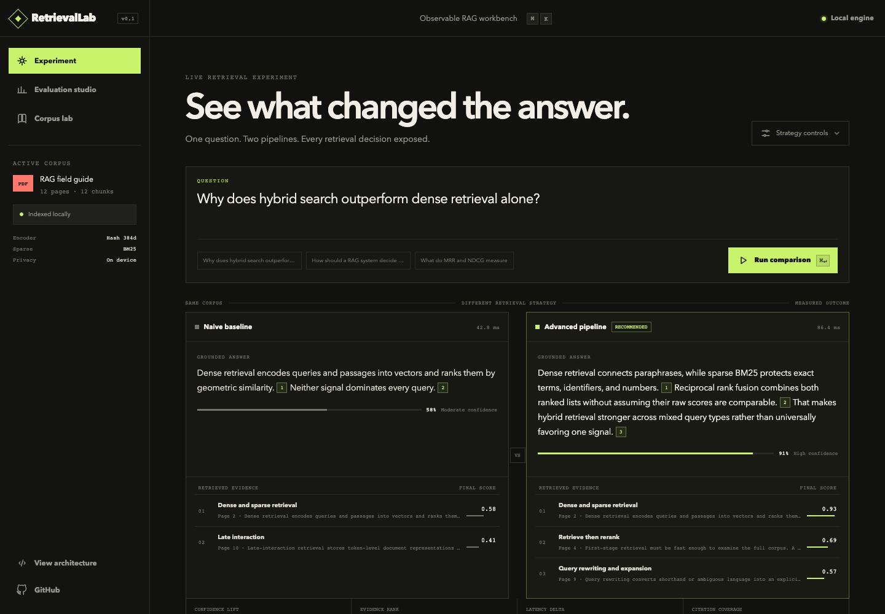

# RetrievalLab

A local retrieval workbench for comparing ranking methods, inspecting evidence, and
reproducing evaluation results. Explore a RAG pipeline with page citations and traces,
or test whether documents satisfying every condition rank ahead of partial matches.

The default uses a deterministic feature-hash encoder and requires no API key or
neural-model download. Optional neural models are configured separately.

**Evidence status:** the coverage-first candidate is rejected on the pinned MultiConIR
subset. BM25 performs better. The synthetic diagnostic and ordinary RAG demo do not
override that result.

[Try locally](#quick-start) · [External result](#the-result-including-the-failure) · [Reproduce](#reproduce-the-research-artifacts) · [Limits](#research-claims-policy)



*Existing repository screenshot. Without the local API, the dashboard shows committed
artifacts and a bundled replay; live ranking and condition editing require the API.*

## Quick start

### Docker

Requires Docker with Docker Compose. Run from a new checkout:

```bash
git clone https://github.com/mrinoybanerjee/retrievallab.git
cd retrievallab
docker compose up --build
```

Open [http://localhost:3000](http://localhost:3000). API docs are at [http://localhost:8000/docs](http://localhost:8000/docs).

### Native development

From the repository root, with Python 3.11+, uv, Node.js 24, and pnpm 11.9 available
(the CI workflow uses Python 3.13, Node.js 24, and pnpm 11.9.0):

```bash
uv sync --extra dev
uv run python scripts/build_demo_pdf.py
uv run uvicorn services.api.app.main:app --reload
```

In a second terminal:

```bash
cd apps/web
pnpm install --ignore-scripts
pnpm dev
```

The API has no authentication and is intended for local development. Do not expose
port 8000 publicly. Docker Compose publishes ports 3000 and 8000 using the default
host bindings; these are not restricted to loopback in the supplied configuration.

If the API is absent, read-only committed artifacts and the bundled RAG trace remain available. Live query execution and condition editing are clearly identified as local-API measurements.

## The result, including the failure

The initial coverage-first sparse candidate looked perfect on a 16-case synthetic diagnostic. On the pinned external MultiConIR Task 2 subset, it lost clearly to ordinary BM25. RetrievalLab commits both artifacts and labels the candidate **rejected**.

| Pinned MultiConIR subset | Complete before partial @10 | p50 CPU | Mean postings |
|---|---:|---:|---:|
| Feature-hash dense | 36.93% | 0.379 ms | — |
| Dense + BM25 RRF | 44.19% | 0.503 ms | 346.61 |
| **Monolithic BM25** | **68.81%** | **0.150 ms** | **346.61** |
| Coverage-first sparse candidate | 60.46% | 0.390 ms | 770.07 |

Candidate delta versus the strongest control: **−8.35 points**, paired bootstrap 95% CI **[−9.83, −6.83]**, 5,000 resamples. It assembled only 1.93 condition tuples per query after anchoring, but touched 2.22× as many postings and took 2.60× the p50 time of BM25. That is not a quality, latency, or cost Pareto win.

This negative result is useful: it kills an attractive scoring idea before model training and localizes the remaining opportunity to **safe sparse traversal and pruning**, not another aggregation formula. See the [research protocol](docs/FRONTIER_RETRIEVAL_RESEARCH_PLAN.md), [dated literature audit](docs/FINAL_RESEARCH_AUDIT_2026-08-02.md), and [evaluation contract](docs/EVALUATION.md).

## What you can explore

- External and synthetic research suites with an explicit evidence-source toggle.
- Ten retrieval controls: BM25, BM25-AND, dense, hybrid RRF, additive, min, product, harmonic, distinct support, and the experimental candidate.
- Live atomic-condition editing and a per-document evidence matrix.
- Paired bootstrap confidence intervals, exact paired sign tests, and Holm correction.
- Postings touched, score updates, tuples assembled, index bytes, latency, and CPU time per successful retrieval.
- Page-aware PDF ingestion, citations, query rewriting, dense + BM25 fusion, reranking, MaxSim, grounding, and abstention.
- Sixty ordinary RAG golden cases with hit rate, MRR, NDCG@10, abstention accuracy, and failures.
- SSE execution traces and an evidence drawer designed for explanation rather than decoration.

## Reproduce the research artifacts

These commands use `make` and the native Python environment above. The synthetic
diagnostic is self-contained:

```bash
make phase0
make verify-research
```

The external artifact is derived from the official Apache-2.0 MultiConIR repository at commit `9884fb3e1e5c06c9e026aa0042a679412dad1425`. Raw source data is intentionally not vendored.

```bash
git clone https://github.com/EIT-NLP/MultiConIR.git /tmp/MultiConIR
git -C /tmp/MultiConIR checkout 9884fb3e1e5c06c9e026aa0042a679412dad1425
make multiconir MULTICONIR_SOURCE=/tmp/MultiConIR
```

The adapter uses the benchmark-provided structured `Query10` conditions as oracle structure, not a production natural-language parser. It processes 2,299 of 2,307 rows; the eight unparseable source rows, SHA-256 input receipt, license, query format, and exact revision are recorded in the report. Only aggregate results, ten attributed case examples, and eight bounded parser-error excerpts are committed. See [third-party notices](THIRD_PARTY_NOTICES.md).

## Ordinary RAG benchmark

The separate `demo-v1` regression suite contains 48 answerable questions and 12 unsupported questions.

| Metric | Naive local baseline | Advanced pipeline | Delta |
|---|---:|---:|---:|
| Hit rate @5 | 88.3% | **96.7%** | +8.3 pts |
| MRR | 73.9% | **94.3%** | +20.4 pts |
| NDCG @10 | 78.0% | **94.9%** | +16.9 pts |
| Abstention accuracy | 90.0% | **98.3%** | +8.3 pts |

These deterministic demo-corpus results validate the workbench, not general RAG superiority. Shared-runner latency is informational.

## Architecture

```text
question
  ├─ baseline: local dense top-k ─────────────────────┐
  └─ advanced: rewrite → dense + BM25 → RRF → rerank │
                    → MaxSim → parent context ────────┤
                                                      ↓
                                   grounding → answer or abstain

atomic conditions → sparse index → 9 controls + candidate
                                  → paired metrics + work counters
                                  → external/synthetic evidence dashboard
```

The default uses an inspectable 384-dimensional feature-hash encoder. Optional SentenceTransformers and CrossEncoder models are lazy-loaded; see [architecture](docs/ARCHITECTURE.md).

## Project layout

```text
apps/web/                    Next.js research dashboard
services/api/                FastAPI, SSE, and interactive probes
packages/retrieval/          retrieval engine, sparse experiment, statistics
data/benchmarks/             committed measurement artifacts
data/research/               deterministic synthetic diagnostic
scripts/                     fixture, adapter, and benchmark entrypoints
docs/                        architecture, protocol, audit, evaluation
tests/                       unit and API integration tests
```

## Research claims policy

Committed evidence may support statements about the exact pinned artifacts only. It does **not** support state-of-the-art, publication-readiness, production-economics, first-ever, or breakthrough claims. A future method must pass two external benchmark families, parser robustness, ordinary-retrieval regression, matched statistics, and a scale cost/latency gate before promotion.

## Privacy

Uploaded PDF text stays in process memory. Remote providers are off by default. If query-only web fallback is explicitly enabled, uploaded text and retrieved passages are not sent with the request. See [SECURITY.md](SECURITY.md).

## License and provenance

RetrievalLab's original code is MIT licensed; see [LICENSE](LICENSE). The pinned
MultiConIR-derived aggregates, ten transformed examples, and eight parser-error
excerpts retain their Apache-2.0 attribution in [third-party notices](THIRD_PARTY_NOTICES.md).
Raw upstream data is not redistributed.

## Contributing

Issues and focused pull requests are welcome. Start with [CONTRIBUTING.md](CONTRIBUTING.md). Retrieval changes must add evidence, preserve negative results, and state whether a result is measured, estimated, diagnostic, or unavailable.

Built by [Mrinoy Banerjee](https://github.com/mrinoybanerjee) as an open, inspectable study of retrieval quality and research discipline.
