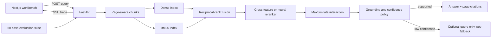

# Architecture

## Why this structure

The retrieval package has no dependency on FastAPI or React. It can be tested through direct function calls, exposed through the CLI, or used by the API. The API owns concurrency, job state, input boundaries, and event delivery. The dashboard consumes typed public contracts and includes an explicitly labelled replay mode so it remains presentable when the API is offline.

The first release uses direct in-memory repositories. There is no speculative vector database or queue abstraction; a second backend should exist before an interface is extracted.

## Observability boundary

Every pipeline stage emits a structured event after it completes. The elapsed time is measured from the pipeline start, so the frontend can render a truthful waterfall. Cache hits are explicit events. Errors are terminal unless the failure policy identifies a safe degraded path.
